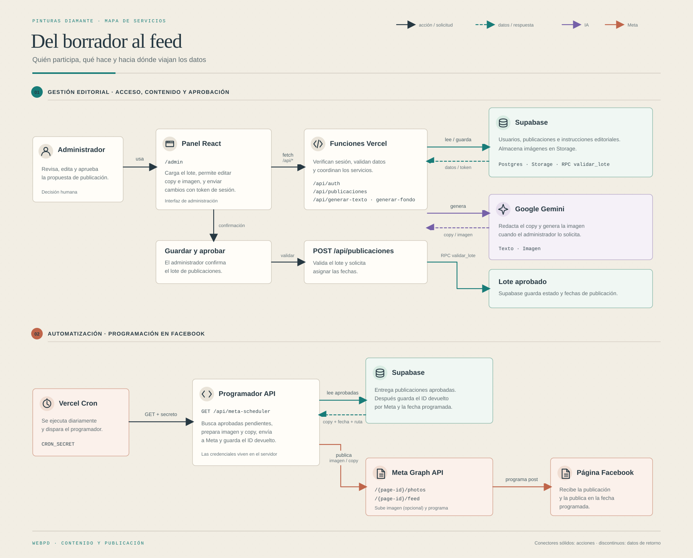
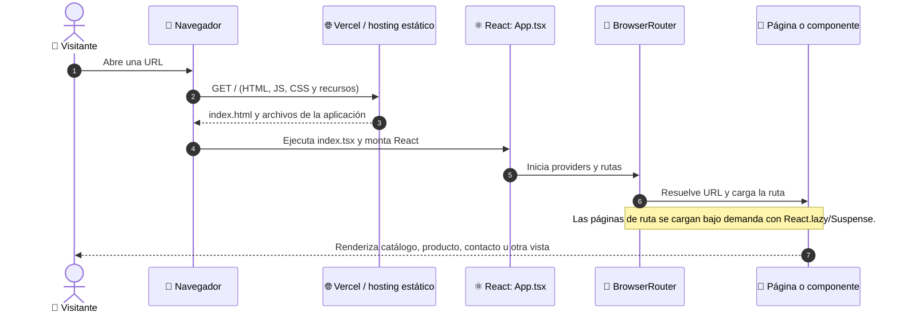
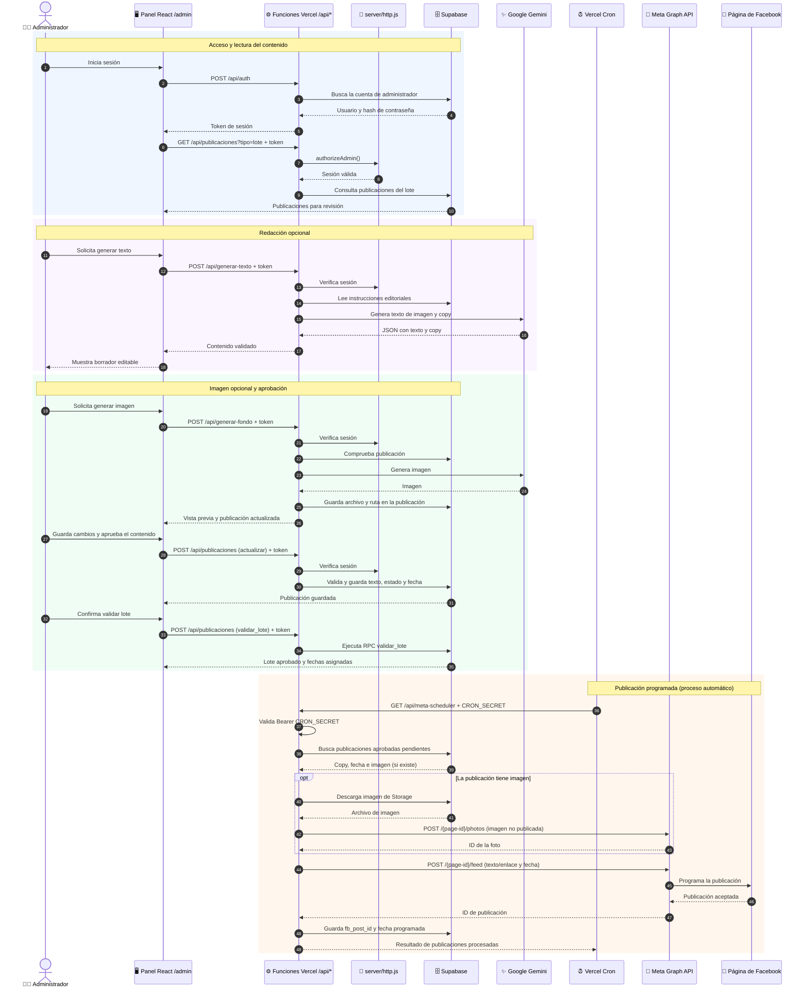

# Diagrama visual de secuencia — Webpd

Mapa de los recorridos principales de la aplicación: navegación pública y administración de publicaciones de Facebook. Los iconos identifican a cada parte y las flechas indican a qué función o servicio se dirige cada solicitud.

## Partes y responsabilidades

| Icono | Parte | Qué hace y a dónde dirige el trabajo |
|---|---|---|
| 👤 | Visitante / administrador | Navega el sitio o gestiona contenido desde `/admin`. |
| 🧭 | Navegador | Descarga la aplicación y envía solicitudes HTTP al mismo dominio. |
| ⚛️ | React (`App.tsx`) | Inicializa providers, medición y rutas; carga las páginas bajo demanda. |
| 🖥️ | Panel admin | Envía solicitudes a `/api/*` con el token de sesión. |
| ⚙️ | API serverless (`api/*.js`) | Valida entradas y sesión; coordina base de datos y servicios externos. |
| 🔐 | Autenticación (`server/http.js`) | Valida credenciales y tokens de administrador. |
| 🗄️ | Supabase | Guarda usuarios, publicaciones y configuración; almacena imágenes generadas. |
| ✨ | Google Gemini | Genera textos e imágenes cuando el administrador lo solicita. |
| ⏰ | Vercel Cron | Ejecuta diariamente `/api/meta-scheduler` para procesar publicaciones pendientes. |
| 📣 | Meta Graph API | Recibe imágenes y publicaciones programadas para una página de Facebook. |
| 📘 | Página de Facebook | Recibe y publica el contenido en la fecha acordada. |

## 1. Navegación del sitio

## 2. Administración, generación y programación en Facebook

## Rutas y servicios involucrados

| Solicitud | Función principal | Destino |
|---|---|---|
| `POST /api/auth` | Inicia sesión o cambia contraseña | Supabase `usuarios` |
| `GET /api/publicaciones?tipo=lote` | Carga el lote activo | Supabase `publicaciones` |
| `POST /api/publicaciones` | Actualiza publicaciones o valida el lote | Supabase y RPC `validar_lote` |
| `POST /api/generar-texto` | Genera y valida copy editorial | Gemini; instrucciones desde Supabase |
| `POST /api/generar-fondo` | Genera imagen y la vincula a una publicación | Gemini y Supabase Storage |
| `GET /api/meta-scheduler` | Busca aprobadas y programa publicaciones | Supabase y Meta Graph API |
| `GET /api/imagen-publicacion` | Genera una vista previa de la imagen | Supabase Storage y Vercel OG |

### Nota sobre permisos de Meta

El publicador del proyecto usa un **token de página** del lado del servidor (`META_PAGE_ID`, `META_PAGE_ACCESS_TOKEN` y `META_GRAPH_API_VERSION`) para enviar solicitudes a `/{page-id}/photos` y `/{page-id}/feed`. Los scopes `developer_tools_mcp_app_read` y `developer_tools_mcp_app_management` no son permisos válidos de Facebook Login: no los agregues. Para crear publicaciones, el permiso de Meta relevante es `pages_manage_posts`; si tu flujo OAuth necesita listar páginas y obtener el token de página, agrega también `pages_show_list` y `pages_read_engagement`. No configures esos permisos como scopes del MCP.
